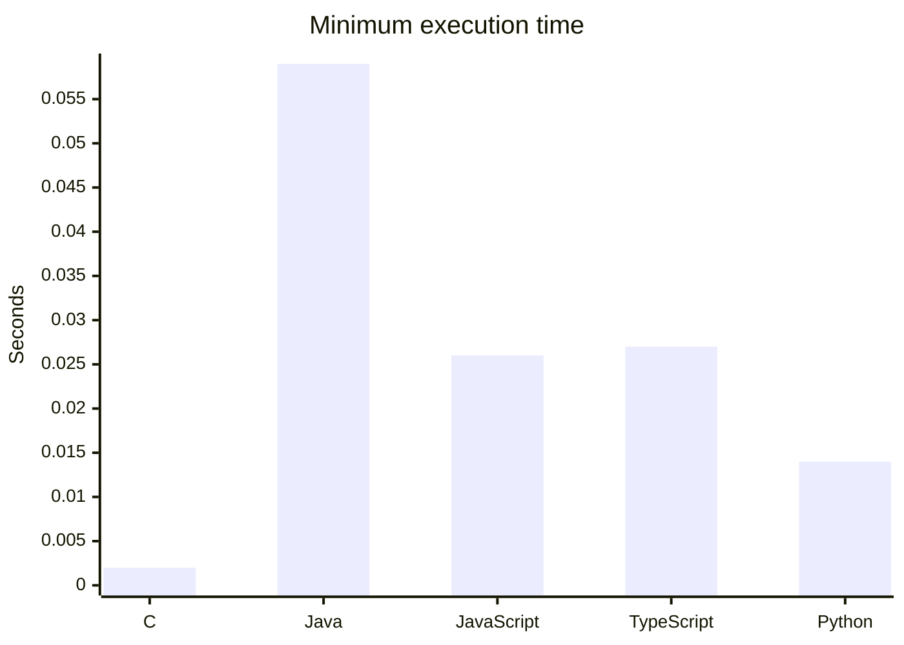

| Language | Median elapsed time (seconds) | Minimum elapsed time (seconds) |
| --- | ---: | ---: |
| C | 0.0020 | 0.002 |
| Java | 0.0615 | 0.059 |
| JavaScript | 0.0290 | 0.026 |
| TypeScript | 0.0290 | 0.027 |
| Python | 2.0150 | 10.014 |

### C output (last run)

    Final value of x: -2147483648
    Final value of y: 1001
    Execution time: 0.040 ms

### Java output (last run)

    Final value of x: 0
    Final value of y: 1001
    Execution time: 8 ms

### JavaScript output (last run)

    Final value of x: Infinity
    Final value of y: 1001
    Execution time: 3 ms

### TypeScript output (last run)

    Final value of x: Infinity
    Final value of y: 1001
    Execution time: 2 ms

### Python output (last run)

    Final value of x: 10000000000000000000000000000000000000000000000000000000000000000000000000000000000000000000000000000000000000000000000000000000000000000000000000000000000000000000000000000000000000000000000000000000000000000000000000000000000000000000000000000000000000000000000000000000000000000000000000000000000000000000000000000000000000000000000000000000000000000000000000000000000000000000000000000000000000000000000000000000000000000000000000000000000000000000000000000000000000000000000000000000000000000000000000000000000000000000000000000000000000000000000000000000000000000000000000000000000000000000000000000000000000000000000000000000000000000000000000000000000000000000000000000000000000000000000000000000000000000000000000000000000000000000000000000000000000000000000000000000000000000000000000000000000000000000000000000000000000000000000000000000000000000000000000000000000000000000000000000000000000000000000000000000000000000000000000000000000000000000000000000000000000000000000000000000000000000
    Final value of y: 1001
    Execution time: 0.1659393310546875 ms
